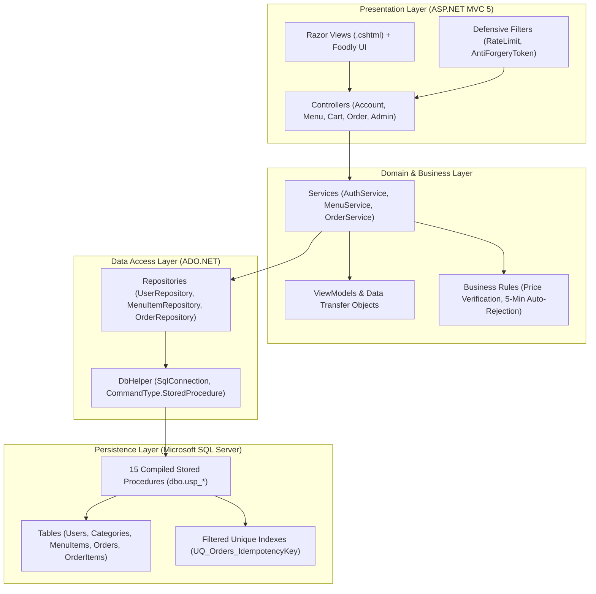

# Foodly Kitchen — Enterprise Food Delivery & Kitchen Operations Platform

[](https://dotnet.microsoft.com/)
[](https://docs.microsoft.com/en-us/dotnet/csharp/)
[](https://dotnet.microsoft.com/apps/aspnet/mvc)
[](https://www.microsoft.com/sql-server)
[](https://getbootstrap.com/)
[](#security-architecture--defense-in-depth)
[](LICENSE)
[](#author--credits)

**Foodly Kitchen** is an enterprise-grade, high-performance online food ordering and kitchen dispatch web platform built with **C#**, **ASP.NET MVC 5**, **.NET Framework 4.8**, and **Microsoft SQL Server**. Engineered with strict Clean Architecture principles, the platform enforces mandatory Stored Procedure data access, server-authoritative checkout validation, PCI-DSS compliant payment processing, and defense-in-depth protection against Insecure Direct Object References (IDOR), credential stuffing, and SQL injection.

---

## Table of Contents

- [Architectural Overview](#architectural-overview)
- [Key Features](#key-features)
- [Security Architecture & Defense-in-Depth](#security-architecture--defense-in-depth)
- [Technology Stack](#technology-stack)
- [Database Architecture & Stored Procedures](#database-architecture--stored-procedures)
- [Project Directory Structure](#project-directory-structure)
- [Getting Started & Local Setup](#getting-started--local-setup)
- [Pre-configured Demo Credentials](#pre-configured-demo-credentials)
- [Author & Credits](#author--credits)
- [License](#license)

---

## Architectural Overview

Foodly Kitchen follows a decoupled **N-Tier Clean Architecture** with strict Separation of Concerns (SoC) and single-direction dependency flows:



---

## Key Features

### Customer Experience & Dynamic Showcase
- **Dynamic Culinary Stage**: Organic rising steam plumes generated using compositor-accelerated SVG curves (`transform: translate3d(...) scale(...)` and `opacity`) at 60fps with zero layout reflow.
- **Interactive Dish Switcher**: Seamless cross-fading tab selector showcasing signature dishes (**Hyderabadi Dum Biryani**, **Artisan Pepperoni Pizza**, and **Paneer Butter Masala Combo**).
- **Aroma & Dispatch Telemetry**: Real-time kitchen dispatch badges and floating aroma cards that reflow into a clean, docked flex strip on mobile screens (`< 768px`).
- **Full Menu Browsing & Filtering**: Filter by category, vegetarian dietary preference, search keywords, and price ranges with instant sorting (Popular, Price: Low-to-High, Price: High-to-Low, Rating).
- **Session-Backed Shopping Cart**: Asynchronous AJAX cart interactions with automatic doorstep delivery fee calculation (free delivery on orders > INR 500).
- **Multi-Method Checkout**: Support for **UPI Apps** (GPay, PhonePe, Paytm, CRED, Custom VPA), **Credit/Debit Cards** (Visa, Mastercard, RuPay), **NetBanking** (HDFC, ICICI, SBI, Axis, Kotak), and **Cash on Delivery (COD)**.
- **Personal Order History**: Real-time tracking of current and past culinary journeys with live status badges (`Pending`, `Accepted`, `Rejected`) and itemized receipts.

### Kitchen & Restaurant Operations (Admin Portal)
- **Live 60-Second Order Queue**: Partitioned tabbed dashboard (`Pending`, `Accepted`, `Rejected`) with live countdown timers and instant action buttons.
- **5-Minute Auto-Rejection Engine**: SARGable T-SQL stored procedure logic automatically transitioning unconfirmed pending orders older than 5 minutes to `Rejected` status.
- **Menu Catalog & Inventory Controls**: Real-time toggling of item availability (`Available` vs `Out of Stock`) and instant pricing updates with server-side validation.
- **Decoupled Order & Payment Lifecycles**: Strict architectural separation between kitchen prep status and financial transaction capture state.

---

## Security Architecture & Defense-in-Depth

The codebase has undergone a comprehensive defensive security audit and implements rigorous protection mechanisms:

| Vector | Defensive Implementation |
| :--- | :--- |
| **Anti-IDOR (Insecure Direct Object Reference)** | Stored procedure `dbo.usp_Order_GetById` enforces row-level authorization (`WHERE o.OrderId = @OrderId AND (@IsAdmin = 1 OR o.UserId = @UserId)`). Attempts by authenticated users to access other customers' orders are intercepted and blocked. |
| **100% Stored Procedures** | Direct inline/ad-hoc SQL queries are strictly prohibited across the entire solution. All SQL queries execute via compiled stored procedures with strongly typed `SqlParameter` objects, eliminating SQL injection. |
| **Zero Dynamic SQL** | Zero stored procedures use `EXEC(@sql)` or `sp_executesql` with dynamic concatenation; all execution plans are precompiled and SARGable. |
| **Server-Authoritative Pricing** | Cart item prices submitted by clients are completely discarded. `OrderService.PlaceOrderAsync` queries `dbo.MenuItems` directly to compute subtotals, delivery fees, and grand totals on the server. |
| **PCI-DSS Compliance** | Zero raw credit card numbers, CVVs, or expiration dates are persisted. Only masked audit references (e.g., `Visa ending in **** 4242`) and payment transaction IDs are stored. |
| **Sliding Window IP Rate Limiting** | Reverse-proxy-aware `[RateLimit]` action filter throttles brute-force attempts on `/Account/Login` (6/min), `/Account/AdminLogin` (5/min), and `/Account/Register` (5/min) with **HTTP 429 Too Many Requests**. |
| **Idempotency & Double-Charge Protection** | Each checkout generates a unique `IdempotencyToken` enforced by a database unique filtered index `UQ_Orders_IdempotencyKey`. Concurrent submissions return the existing order safely. |
| **Cryptographic PBKDF2 Password Hashing** | Passwords hashed using PBKDF2 (`Rfc2898DeriveBytes`) with 10,000 iterations and a cryptographically secure 128-bit per-user salt generated via `RNGCryptoServiceProvider`. |
| **HTTP Security Headers** | `Web.config` enforces `X-Content-Type-Options: nosniff`, `X-Frame-Options: SAMEORIGIN`, `X-XSS-Protection: 1; mode=block`, and `Referrer-Policy: strict-origin-when-cross-origin`. |

---

## Technology Stack

| Layer | Technology |
| :--- | :--- |
| **Target Framework** | .NET Framework 4.8 |
| **Language** | C# 7.3 |
| **Web Architecture** | ASP.NET MVC 5.2.9 |
| **Database** | Microsoft SQL Server 2019 / 2022 / SQL Express |
| **Data Access** | ADO.NET (`System.Data.SqlClient`) strictly via Stored Procedures |
| **Authentication** | FormsAuthentication with encrypted ticket cookies and role principal resolution |
| **Styling & UI** | Custom CSS3 (`foodly.css`), Bootstrap 5.2.3, FontAwesome 6 Free |
| **Client Scripts** | jQuery 3.7.0, jQuery Validation & Unobtrusive, Bootstrap 5 Bundle (with Popper.js) |
| **Build System** | Microsoft Build Engine (MSBuild) 18.x / Visual Studio 2022 |

---

## Database Architecture & Stored Procedures

The database `FoodDeliveryDb` consists of 5 normalized relational tables and 15 compiled stored procedures:

### Relational Schema
- `dbo.Users`: User credentials (PBKDF2 hash & salt), roles (`Customer`, `Admin`), phone, and delivery address.
- `dbo.Categories`: Master food categories (Biryani, Pizzas, Burgers, Indian Curries, etc.).
- `dbo.MenuItems`: Dishes with price, availability flag, rating, preparation time, and category foreign key.
- `dbo.Orders`: Order headers with timestamps, delivery address, phone, total amount, status, payment method, payment status, transaction ID, masked details, and idempotency key.
- `dbo.OrderItems`: Line items associated with each order, capturing item ID, snapshot name, unit price, and quantity.

### Stored Procedures
| Procedure Name | Description |
| :--- | :--- |
| `dbo.usp_User_Register` | Registers a new user with duplicate email detection. |
| `dbo.usp_User_GetByEmail` | Retrieves a user by email for credentials verification. |
| `dbo.usp_User_GetById` | Retrieves user profile by primary key ID. |
| `dbo.usp_Category_GetAll` | Retrieves all active food categories. |
| `dbo.usp_MenuItem_GetAll` | Customer catalog query with category, veg, and search filtering. |
| `dbo.usp_MenuItem_GetAdminAll` | Comprehensive menu listing for inventory administration. |
| `dbo.usp_MenuItem_GetById` | Retrieves individual menu item for cart and checkout verification. |
| `dbo.usp_MenuItem_ToggleAvailability`| Toggles item in-stock/out-of-stock state. |
| `dbo.usp_MenuItem_UpdatePrice` | Updates an item's unit price with audit timestamp. |
| `dbo.usp_Order_Create` | Atomic transaction inserting order header and line items via XML payload with idempotency check. |
| `dbo.usp_Order_GetById` | Retrieves order details enforcing Anti-IDOR user ownership or admin privilege. |
| `dbo.usp_Order_GetTodayOrdersByStatus`| Retrieves today's orders partitioned by status for kitchen operations. |
| `dbo.usp_Order_UpdateStatus` | Transitions order status from Pending to Accepted or Rejected. |
| `dbo.usp_Order_AutoRejectPending` | SARGable auto-rejection of pending orders older than 5 minutes. |
| `dbo.usp_Order_GetCustomerHistory` | Row-level order history query for an authenticated customer. |

---

## Project Directory Structure

```text
FoodDeliveryApp/
├── App_Start/
│   ├── BundleConfig.cs               # Script & style bundling (bootstrap.bundle.js)
│   ├── FilterConfig.cs               # Global MVC exception filter registration
│   └── RouteConfig.cs                # URL routing table definitions
├── Content/
│   ├── foodly.css                    # Master Foodly design system & steam physics
│   ├── images/
│   │   ├── dishes/                   # High-res authentic dish photography
│   │   └── branding/                 # Vector SVG and PNG brand assets
│   └── Site.css
├── Controllers/
│   ├── AccountController.cs          # Customer & Admin login, registration, sign-out
│   ├── AdminController.cs            # [Authorize(Roles="Admin")] orders & menu management
│   ├── CartController.cs             # Session shopping cart with input bounds checking
│   ├── HomeController.cs             # Landing page, specials, about, contact
│   ├── MenuController.cs             # Food menu catalog, filters, search, sorting
│   └── OrderController.cs            # Checkout, atomic placement, Anti-IDOR confirmation
├── Data/
│   ├── DbHelper.cs                   # ADO.NET helper connecting strictly via Stored Procedures
│   └── Repositories/                 # IUserRepository, IMenuItemRepository, IOrderRepository
├── Database/
│   ├── 01_CreateDatabase.sql         # Database schema, tables, foreign keys, indexes
│   ├── 02_StoredProcedures.sql       # Initial stored procedures
│   ├── 03_SeedData.sql               # Default users, categories, and signature dishes
│   ├── 04_PaymentSchemaUpdate.sql    # Multi-method payment schema & idempotency index
│   └── 05_OrderGetByIdStoredProc.sql # Anti-IDOR row-level authorization stored procedure
├── Infrastructure/
│   └── Filters/
│       └── RateLimitAttribute.cs     # Sliding-window IP rate limit action filter
├── Models/
│   ├── Category.cs, MenuItem.cs, Order.cs, OrderItem.cs, User.cs
│   └── ViewModels/                   # Strongly typed contracts for views
├── Scripts/
│   ├── bootstrap.bundle.min.js       # Bootstrap 5 + Popper.js
│   ├── jquery-3.7.0.min.js           # Core DOM library
│   └── jquery.validate.min.js        # Client validation
├── Views/                            # Strongly typed Razor templates
├── Global.asax / Global.asax.cs      # FormsAuthentication role ticket decryption
├── Web.config                        # Configuration, connection string, security headers
├── LICENSE                           # MIT Open Source License
└── README.md                         # Comprehensive documentation
```

---

## Getting Started & Local Setup

### Prerequisites
- **Windows 10 / 11** or **Windows Server**
- **Visual Studio 2022** (with *.NET desktop development* and *ASP.NET and web development* workloads)
- **.NET Framework 4.8 Developer Pack**
- **Microsoft SQL Server 2019 / 2022** or **SQL Server Express**
- **SQL Server Management Studio (SSMS)** or **sqlcmd**

### 1. Clone the Repository
```bash
git clone https://github.com/Sailen-Mondal/FoodDeliveryApp.git
cd FoodDeliveryApp
```

### 2. Set Up the Database
Execute the SQL migration scripts in sequence against your SQL Server instance (`.\SQLEXPRESS`):

```powershell
sqlcmd -S ".\SQLEXPRESS" -E -i "Database\01_CreateDatabase.sql"
sqlcmd -S ".\SQLEXPRESS" -d FoodDeliveryDb -E -i "Database\02_StoredProcedures.sql"
sqlcmd -S ".\SQLEXPRESS" -d FoodDeliveryDb -E -i "Database\03_SeedData.sql"
sqlcmd -S ".\SQLEXPRESS" -d FoodDeliveryDb -E -i "Database\04_PaymentSchemaUpdate.sql"
sqlcmd -S ".\SQLEXPRESS" -d FoodDeliveryDb -E -i "Database\05_OrderGetByIdStoredProc.sql"
```

### 3. Configure Connection String
Open `Web.config` and verify or update the connection string to point to your SQL Server instance:

```xml
<connectionStrings>
  <add name="FoodDeliveryDb" 
       connectionString="Data Source=.\SQLEXPRESS;Initial Catalog=FoodDeliveryDb;Integrated Security=True;TrustServerCertificate=True;" 
       providerName="System.Data.SqlClient" />
</connectionStrings>
```

> **Cloud / 12-Factor Override**: You can also set the environment variable `FOODLY_DB_CONNECTION` to inject your database connection string without editing `Web.config`.

### 4. Build and Run
Open `FoodDeliveryApp.sln` in **Visual Studio 2022** and press `F5` (or `Ctrl+F5`) to run under **IIS Express**.

Alternatively, build via CLI:
```powershell
& "C:\Program Files\Microsoft Visual Studio\18\Community\MSBuild\Current\Bin\MSBuild.exe" "FoodDeliveryApp.csproj" /t:Build /p:Configuration=Debug
```

---

## Cloud Deployment (Azure App Service & GitHub Actions)

Foodly Kitchen includes an automated **GitHub Actions CI/CD pipeline** (`.github/workflows/azure-deploy.yml`) pre-configured for **Azure App Service (Windows / .NET Framework 4.8)**:

### 1. Provision Azure Resources
1. In the **Azure Portal**, create an **App Service**:
   - **Publish**: Code
   - **Runtime stack**: .NET Framework 4.8
   - **Operating System**: Windows
   - **Pricing Plan**: Free F1 (or Basic/Standard)
2. Create an **Azure SQL Database** (Free Tier / Serverless) and execute the 5 database migration scripts in `Database/`.
3. In your App Service under **Settings > Configuration > Connection strings**, add:
   - **Name**: `FoodDeliveryDb`
   - **Value**: `Server=tcp:<your-server>.database.windows.net,1433;Initial Catalog=FoodDeliveryDb;User ID=<admin>;Password=<password>;Encrypt=True;TrustServerCertificate=False;Connection Timeout=30;`
   - **Type**: `SQLServer`

### 2. Configure GitHub Actions Deployment
1. On your App Service overview page, click **Download publish profile**.
2. In your GitHub repository, go to **Settings > Secrets and variables > Actions > New repository secret**.
3. Name the secret `AZURE_WEBAPP_PUBLISH_PROFILE` and paste the XML contents of the downloaded publish profile.
4. (Optional) Set the repository variable `AZURE_WEBAPP_NAME` to your App Service name if different from `foodly-kitchen`.
5. Pushing commits to the `main` branch will automatically compile, package, and deploy the application to your live Azure domain.

---

## Pre-configured Demo Credentials

| Role | Email | Password | Access Level |
| :--- | :--- | :--- | :--- |
| **Customer** | `rahul@example.in` | `Password@123` | Browsing, ordering, cart, checkout, personal history |
| **Administrator** | `admin@foodly.in` | `Admin@123` | Live kitchen queue, accept/reject orders, inventory & price management |

*Both login screens feature convenient 1-Click "Fill Demo" credentials buttons for rapid testing.*

---

## Author & Credits

- **Author**: **Sailen Mondal**
- **Role**: Software Engineer & Solutions Architect
- **GitHub**: [@Sailen-Mondal](https://github.com/Sailen-Mondal)

---

## License

This project is licensed under the **MIT License** — see the [LICENSE](LICENSE) file for details.
